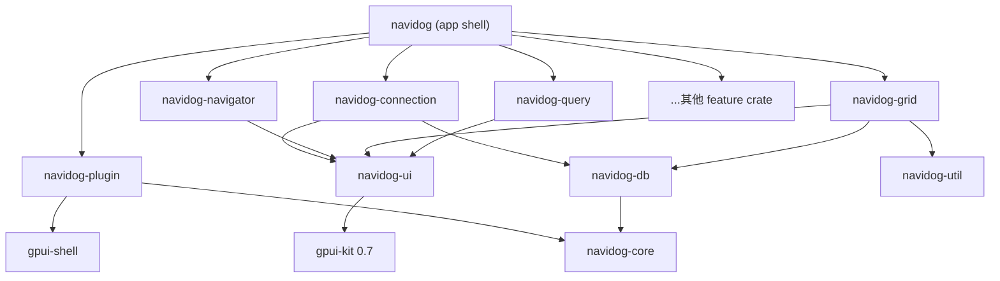
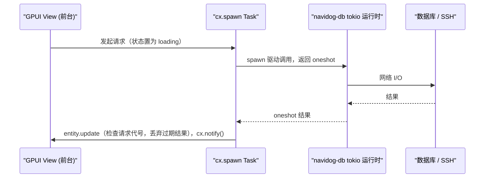

# navidog 设计总览

navidog 用 [gpui-kit](https://gpui-kit.com/zh-CN/docs/) 全家桶（GPUI、`gpui-base`、`gpui-component`、`gpui-shell`）复刻 Navicat Premium 17.3.5 macOS 版，浅色和深色外观都复刻。本文是所有设计文档的入口：先读这里，再按里程碑读对应的模块规格。

## 1. 文档地图

| 文档 | 内容 |
| --- | --- |
| [CONTEXT.md](../../CONTEXT.md) | 术语表 |
| [AGENTS.md](../../AGENTS.md) | 给 Agent 的开发流程、已知的坑和验证步骤 |
| [progress.md](../progress.md) | 实现进度：里程碑、当前里程碑任务、功能状态、临时偏差 |
| 本文 | 决策记录、架构、工程规则、里程碑 |
| [01-feature-inventory.md](01-feature-inventory.md) | 全量功能清单（编号、摘要、验收要点、Navicat 帮助页、里程碑） |
| [02-design-tokens.md](02-design-tokens.md) | 设计 token 表（每项附来源） |
| [03-plugin-api.md](03-plugin-api.md) | 注册表、插件 manifest、HostModule `navidog`、JS 驱动协议 |
| [10-shell.md](10-shell.md) | M1：主窗口、工具栏、Dock、菜单栏、状态栏 |
| [11-connection.md](11-connection.md) | M1：连接管理与连接对话框 |
| [20-objects.md](20-objects.md) | M2：对象树、对象选项卡、信息窗格、编辑器选项卡 |
| [21-table-viewer.md](21-table-viewer.md) | M2：表查看器与结果网格（含技术验证的判定规则） |
| [db/](db/) | MySQL、PostgreSQL、SQLite 以外数据库的专属功能清单 |

每个里程碑开工前，先在本目录补齐该里程碑的详细规格（编号 `1x-*.md`），规格 PR 合并后再开代码 PR。

## 2. 参考资料与工具

基线的尺寸、颜色、文案和行为全部来自本机安装的 Navicat，但 Navicat 的资源是专有文件，**只在本地使用**：导出结果写到 gitignore 的 `reference/` 目录，仓库里只提交换算后的 token 和我们自己写的文案、规格。

| 命令 | 产出 | 用途 |
| --- | --- | --- |
| `cargo xtask nib-dump` | `reference/nib/*.json` | 718 个编译后 nib 的视图树：类名、`NSFrame`、文案、字体、菜单 |
| `cargo xtask nib-tree <名称>` | 终端输出 | 以紧凑树形查看某个 nib，写规格时引用控件路径 |
| `cargo xtask help-index` | `reference/help-index.json` | 400 个中文帮助页的文件名与标题，功能清单的数据源 |
| `swift tools/colors-dump.swift` | `reference/colors.json` | AppKit 语义色在浅色和深色下的 sRGB 值 |
| `swift tools/ax-dump.swift` | `reference/ax/*.json` | 运行中 Navicat 的窗口元素几何和完整菜单栏，需要给终端授予“辅助功能”权限 |
| `cargo test -p navidog --test snapshot` | `target/snapshots/*.png` | 用 Metal headless 渲染器把 navidog 主窗口和对话框画成 PNG（浅色、深色），供并排目测，不需要屏幕录制权限 |
| `swift tools/window-shot.swift <进程名> <png>` | 指定的 PNG | 截取运行中应用（例如 Navicat）的主窗口，需要给终端授予“屏幕录制”权限 |

帮助页原文位于 `/Applications/Navicat Premium.app/Contents/Resources/zh-Hans.lproj/Navicat Help/`，规格中只引用文件名（例如 `con_ssh_settings.html`），不复制原文。中文界面文案参考 `zh-Hans.lproj/*.strings` 中的术语，由我们自己写入 `locales/`，不批量导入。

## 3. 决策记录

以下决策在立项时逐条确认，修改任何一条都要先更新本节。

**产品**
1. 基线：Navicat Premium 17.3.5 macOS 版，浅色、深色都复刻。
2. “像素级”的含义：不做截图对比。尺寸取自 nib 和 AX，颜色取自 AppKit 语义色；每个 token 标明来源；里程碑验收时并排目测。
3. 不提取 Navicat 的图标和 logo。使用 Lucide 加自绘近似 SVG，尺寸和位置一致，图形不照抄；logo 用 navidog 自己的。
4. 功能范围：所有功能都写进[功能清单](01-feature-inventory.md)，分里程碑实现。范围覆盖 MySQL、PostgreSQL、SQLite 适用的全部功能，外加 AI 助手和替代 Navicat Cloud 的同步功能。其他数据库的专属功能也完整写进 [db/](db/)。
5. 一期数据库：MySQL/MariaDB、PostgreSQL、SQLite。
6. 平台：macOS 首发并做像素校准（最低 macOS 15，gpui-kit 的要求）；Windows 和 Linux 保持可编译，不承诺视觉。
7. 界面语言：简体中文和英文。
8. 插件：基于 `gpui-shell`，开放命令和菜单、导入导出格式、单元格格式化器、JS 驱动、Dock 面板五类扩展点。
9. 插件只从本地目录 `~/Library/Application Support/navidog/plugins/` 加载，manifest 声明能力，首次启用时弹窗授权，不做插件市场。
10. 与“更合理的做法”冲突时以 Navicat 为准，偏差写进模块规格并给出理由。已知偏差：主窗口用 Dock，允许拖拽停靠，而 Navicat 是固定窗格。
11. 许可证 Apache-2.0，禁止引入 GPL 依赖。
12. Bundle ID：`ci.nn.navidog`。
13. 不做遥测和远程崩溃上报，日志用 `tracing` 写到 `~/Library/Logs/navidog/`；SQL 历史日志按 Navicat 的方式单独记录。
14. 自动更新：发布阶段采用 Sparkle 2，appcast 托管在 GitHub Releases；之前只提供“检查更新”，跳转到 Releases 页面。

**技术**
1. 依赖 `gpui-kit = "0.7"`，提交 `Cargo.lock`。gpui-kit 自己精确锁定 `gpui-pre`，不要单独覆盖任何 `gpui-pre-*`。
2. rem 基准 `theme.font_size = 13px`（macOS 控件默认字号）。
3. 裸 `px(...)` 和原始颜色只允许出现在 `navidog-ui` 的 token 和主题定义里，由 CI 检查（见第 5 节）。
4. 组件层采用渐进策略：先用 `gpui-component` 加 Navicat 主题；主题调不到实测值的控件，在 `navidog-ui` 中基于 `gpui-base` 原语重写外观，行为、焦点和无障碍语义沿用原语。
5. 组件能力缺口：先在组件外层补（delegate、自定义渲染）；补不了就基于 `gpui-base` 自建；禁止 fork gpui-kit。结果网格和对象树在 M2 开始时先各做 1 到 2 天的技术验证。
6. 菜单：右键菜单用 `NativeMenu`（macOS 上就是 `NSMenu`）；菜单栏用 `cx.set_menus`，调用前必须先 `cx.bind_keys`；只有必须参与 GPUI 浮层组合的地方（如补全列表）才用 `PopupMenu`。
7. 主窗口布局：`gpui-component` 的 `DockArea`，默认布局照 Navicat 排列，用 `dump/load` 持久化；插件面板注册为 Dock Panel。
8. 驱动层：自定义 trait 加原生驱动（`mysql_async`、`tokio-postgres`、`rusqlite`）。核心是 `Driver` 和 `Session` 两个 trait，按类别分出 `Relational`、`Document`、`KeyValue` 三个 trait，一期只实现 `Relational`。
9. 异步：`navidog-db` 里放一个全局 tokio 多线程运行时；SQLite 走阻塞线程；界面侧用 `cx.spawn` 加 channel 等结果，状态显式区分 idle、loading、loaded、failed，丢弃过期结果。
10. 连接配置存成 JSON，放在 `~/Library/Application Support/navidog/`。密码字段默认用钥匙串里随机生成的本机密钥加密；用户可设置主密码，此时用 Argon2 派生密钥、XChaCha20-Poly1305 加密，启动时解锁一次。
11. 一期连接方式：常规、高级、数据库、SSL、SSH（`russh`）；HTTP 隧道放到 M13，服务端脚本自己写。
12. 注册表从 M1 起建立，内置功能也通过插件将来使用的同一套注册表注册。

**工程**
1. 仓库结构：Cargo workspace，具体见第 4 节。
2. 测试数据库：`docker-compose.yml`（MySQL 8、MariaDB 11、PostgreSQL 16，带种子数据），SQLite 用仓库内的测试文件。
3. CI：GitHub Actions 的 macOS runner，运行 fmt、clippy、单元测试、headless UI 测试和裸值检查；打 tag 时构建 `.dmg`，签名和公证留到 M15。
4. 分支流程：每个里程碑一个分支，通过 PR 合并到 `master`；规格 PR 和代码 PR 分开提。
5. 模块细节：每份模块规格按 Navicat 现有行为写好默认值，提交评审。

## 4. 架构

### 4.1 crate 划分

| crate | 职责 | 创建时机 |
| --- | --- | --- |
| `navidog` | 应用外壳：初始化、窗口、Dock 默认布局、菜单栏、主工具栏骨架、组合各 feature crate。不放功能逻辑。 | M1 |
| `navidog-ui` | Navicat 主题 JSON、具名 token、AppKit 外观皮肤、图标资源 | M1 |
| `navidog-core` | 领域模型（连接、分组）、配置目录、加密存储、注册表 | M1 |
| `navidog-util` | 不依赖界面和驱动的纯函数：SQL 类型名归类、enum/set 列表、十六进制和 JSON 文本 | M2 |
| `navidog-db` | 驱动 trait、三类数据库 trait、tokio 运行时、内置驱动、SSL 和 SSH 隧道 | M1 |
| `navidog-plugin` | gpui-shell 宿主：manifest、授权、HostModule `navidog` | M1 建空壳，M5 实现 |
| `navidog-connection` | 连接对话框、连接管理、导航树中的连接节点操作 | M1 |
| `navidog-navigator` | 导航窗格、对象选项卡、信息窗格 | M2 |
| `navidog-grid` | 结果网格、表查看器 | M2 |
| `navidog-query` | 查询编辑器、结果集、执行计划、查询构建器 | M3 |
| `navidog-designer` | 表、视图、函数等对象设计器 | M4 |
| `navidog-transfer` | 导入导出、数据传输、数据同步、结构同步 | M6、M8 |
| `navidog-model` | 模型与 ER 图 | M7 |
| `navidog-automation` | 备份还原、自动运行 | M9 |
| `navidog-bi` | BI 数据源、图表、仪表板 | M10 |
| `navidog-ai` | AI 助手 | M11 |

规则：
- 依赖只能向下：feature crate 可以依赖 `navidog-ui`、`navidog-core`、`navidog-db`、`navidog-util`，**不能依赖其他 feature crate**。feature 之间通过 `navidog-core` 中的命令、事件和领域 ID 协作。`navidog-util` 不依赖本仓库的其他 crate。
- 每个 feature crate 把自己的 model、service、view、command、dialog 放在一起，禁止建立全局的 `models/`、`views/`、`commands/` 目录。
- 小能力先作为 module 留在最接近的 crate 里，等边界有实际收益再拆成 crate。不依赖界面、也不需要驱动的纯函数例外，直接放 `navidog-util`。
- feature crate 对外只暴露 `init(cx)`、需要被外壳放进 Dock 的 Panel 类型，以及少量公开的 Entity 或命令。

### 4.2 运行时数据流

## 5. gpui-kit 规范在本项目中的落地

gpui-kit 的[编码指南](https://gpui-kit.com/zh-CN/docs/coding-guides)和[设计指南](https://gpui-kit.com/zh-CN/docs/design-guides)是强制规范。以下几条与像素复刻直接相关，单独说明：

- **token 规则**：Navicat 的实测数值只出现在 `navidog-ui` 的 token 和主题 JSON 里，单位是 macOS 的 pt，在 token 定义处换算成 rem（基准 13）。组件代码只引用具名 token（如 `tokens.toolbar.height`），这样应用缩放仍然有效。规范明确允许“主题或 token 定义本身”使用像素值。
- **裸值检查**：`scripts/check-raw-px.sh` 在 `crates/navidog-ui/src/tokens*` 和 `themes/` 之外查找 `px(`、`rgb(`、`rgba(`、`hsla(`、`hsl(`。必须例外的位置（运行时测量的几何、平台边界）在行尾加注释 `// raw-px: <理由>`。
- **rem 缓存**：任何根据布局结果缓存的几何（行高、文本测量、画布尺寸），失效键都必须包含 `window.rem_size()`。
- **命令**：一个命令只定义一个 Action，工具栏、菜单、右键菜单、快捷键共用。快捷键表照 Navicat（见 `hot_keys.html`）。
- **焦点**：可聚焦元素显式 `.tab_stop(true)`；`key_context` 和 `on_action` 挂在同一区域；对话框困住焦点，关闭后把焦点还给打开它的元素。
- **ElementId**：使用稳定的领域 ID（连接 ID、对象路径），禁止用索引、随机值或翻译后的文本。
- **render 纯声明**：render 里不调 `cx.notify()`、不启动任务。
- **大数据**：导航树、对象列表、结果网格必须虚拟化，数据、排序筛选、选择、视口和行渲染分开。
- **i18n**：使用 rust-i18n。每个 crate 根部写 `i18n!("locales", fallback = "en")`，外壳在 `gpui_kit::init` 之前调用 `rust_i18n::extend!(gpui_component)`。切换语言后调用 `cx.refresh_windows()`。
- **测试**：UI 测试用 `#[gpui_kit::test]` 加 `TestAppContext`，通过 `gpui_kit::test::{TestWindowExt, TestAppContextExt}` 驱动真实的点击、键盘和焦点。像素测试（`Window::render_to_image`）只在 macOS 上可用，暂不使用。
- **偏离设计指南**：设计指南要求英文用 sentence case、选中态不用左侧竖条等。凡是 Navicat 的做法与之冲突的，以 Navicat 为准，并在模块规格的“偏差”一节说明。

## 6. 里程碑

| 里程碑 | 内容 | 主要 crate |
| --- | --- | --- |
| M0 | 参考资料工具、总览、功能清单、token 表、插件 API、M1 规格 | 文档、`xtask` |
| M1 | 应用外壳和连接管理 | `navidog`、`navidog-ui`、`navidog-core`、`navidog-db`、`navidog-connection` |
| M2 | 对象树、对象选项卡、信息窗格、表查看器和结果网格 | `navidog-navigator`、`navidog-grid` |
| M3 | 查询编辑器、结果集、执行计划、SQL 美化、历史日志 | `navidog-query` |
| M4 | 表设计器及其他对象设计器 | `navidog-designer` |
| M5 | 插件体系 | `navidog-plugin` |
| M6 | 导入导出向导、导入 `.ncx` 连接 | `navidog-transfer` |
| M7 | 模型和 ER 图 | `navidog-model` |
| M8 | 数据传输、数据同步、结构同步 | `navidog-transfer` |
| M9 | 备份还原、自动运行 | `navidog-automation` |
| M10 | BI | `navidog-bi` |
| M11 | AI 助手 | `navidog-ai` |
| M12 | 同步（本地目录或 Git），替代 Navicat Cloud | `navidog-core` |
| M13 | HTTP 隧道 | `navidog-db` |
| M14 | 其他数据库，按类别接入 | `navidog-db` 及各 feature crate |
| M15 | 发布：签名、公证、DMG、Sparkle 2 | 打包脚本 |

### 每个里程碑的完成标准
- CI 通过：fmt、clippy、单元测试、headless UI 测试、裸值检查。
- 每段不简单的逻辑至少有一个可运行的检查。
- 新增 token 都在 [02-design-tokens.md](02-design-tokens.md) 写明来源；与 Navicat 的偏差都写进模块规格。
- [progress.md](../progress.md) 已同步更新。
- 并排目测通过评审后，PR 合并到 `master`。
