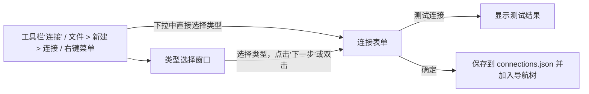

# M1 规格：连接管理

覆盖功能：F-CONN-001 ~ F-CONN-006、F-CONN-008 ~ F-CONN-014、F-CONN-020。

行为来源：`connection.html`、`con_gen_settings*.html`、`con_adv_settings.html`、`con_db_settings.html`、`con_ssl_settings.html`、`con_ssh_settings.html`、`con_compatibility_settings.html`、`connection_color.html`、`virtual_group.html`。

尺寸来源：
- `ConnectionFormConnTypeSelectionModule`：类型选择窗口；
- `ConnectionFormGeneralModule_{mysql,pgsql,sqlite}`：常规页；
- `ConnectionFormAdvancedModule_{mysql,pgsql,sqlite}`：高级页；
- `ConnectionFormCustomDbListModule`：数据库页；
- `ConnectionFormSSLModule`：SSL 页；
- `ConnectionFormSSHModule`：SSH 页；
- `ConnectionFormRemarkModule`：备注页。

## 1. 新建连接流程



### 1.1 类型选择窗口

- 以 sheet 的形式附着在主窗口上，尺寸为 `conn_type.window`。
- 布局：
  - 左栏宽 `conn_type.sidebar_width`，是分类列表：全部、关系型、NoSQL、云；M1 只有“全部”和“关系型”有内容；
  - 右栏顶部是标题“新建连接”（`font.weight.heading`，行高 `conn_type.header_height`）；
  - 其下是搜索行（高 `conn_type.search_row_height`）：左侧文字“选择连接类型:”，右侧是两个视图切换按钮和搜索框（宽 `conn_type.search_width`）；
  - 中间是数据库类型的图标网格（`NSCollectionView` 风格）或列表；
  - 底部栏高 `conn_type.footer_height`：左侧“通过 URI 新建连接…”（M2，禁用），右侧“取消”和“下一步”。
- M1 列出的类型有 MySQL、MariaDB、PostgreSQL、SQLite。其他类型（SQL Server、Oracle、MongoDB、Redis、Snowflake）在 M14 之前不显示（**临时偏差**）。

### 1.2 连接表单窗口

- 标题：新建时为“新建连接 (MySQL)”，编辑时为“编辑连接 - 连接名”。
- 标签页按数据库类型显示：

| 类型 | 标签页 |
| --- | --- |
| MySQL、MariaDB | 常规、高级、数据库、SSL、SSH、备注 |
| PostgreSQL | 常规、高级、数据库、SSL、SSH、备注 |
| SQLite | 常规、高级、数据库、备注 |

  HTTP 页在 M13 加入。
- 底部按钮：左侧“测试连接”，右侧“取消”和“确定”。“确定”是默认按钮（回车触发），在连接名称为空时禁用。
- 窗口整体尺寸和标签页切换控件的样式由代码动态生成，nib 中没有，需要在 M1 验收前用 AX 实测确定（见 token 表第 9 节）。
- M1 中类型选择窗口和连接表单都以主窗口内的模态对话框呈现（`window.open_dialog`），标签页切换用分段样式的 `TabBar`。如果 AX 实测确认 Navicat 用的是独立窗口，再改为 `gpui_kit::open_window`。

## 2. 表单字段

表单布局规则：
- 每一行是“右对齐的标签 + 6pt 间距 + 控件”，标签列宽取本页最长的标签；
- 常规页行高 `form.row.height`，行距 `form.row.gap`；
- 高级页使用紧凑行：行高 `form.row.compact_height`，行距 `form.row.compact_gap`；
- 输入框宽 `form.field.width`，端口和数字类输入框宽 `form.field.width_short`；弹出按钮高 `form.popup.height`；
- 页面左右边距为 `form.margin`。

下表“默认值”一列中标 `*` 的值需要在 M1 验收前对照 Navicat 核对。

### 2.1 常规

| 字段（中文 / 英文） | 控件 | MySQL | PostgreSQL | SQLite | 默认值 |
| --- | --- | --- | --- | --- | --- |
| 连接名称: / Connection Name: | 文本框 300 | ✓ | ✓ | ✓ | 根据主机自动生成，例如 `localhost_3306`* |
| 添加到: / Add To: | 弹出按钮 300 | ✓ | ✓ | ✓ | “我的连接”或当前选中的组 |
| 主机: / Host: | 文本框 300 | ✓ | ✓ | — | `localhost` |
| 端口: / Port: | 文本框 80 | ✓ | ✓ | — | 3306 / 5432 |
| 初始数据库: / Initial Database: | 文本框 300 | — | ✓ | — | `postgres` |
| 类型: / Type: | 单选组 | — | — | ✓ | 现有的数据库文件 |
| 数据库文件: / Database File: | 文件路径选择 300 | — | — | ✓ | 空 |
| 用户名: / User Name: | 文本框 300 | ✓ | ✓ | ✓（加密数据库用） | `root` / `postgres` / 空 |
| 密码: / Password: | 密码框 300 | ✓ | ✓ | ✓ | 空 |
| 保存密码 / Save password | 复选框 | ✓ | ✓ | ✓ | 勾选 |
| 说明文字 | 11pt 次要文字 | ✓ | ✓ | ✓ | “* 所有密码都加密保存在本机” |

- **偏差**：Navicat 的说明文字是“* 所有密码不会保存到 Navicat Cloud”。navidog 没有 Cloud，改成说明密码的加密存储方式。
- SQLite 的“类型”有两个选项：现有的数据库文件、新建 SQLite 3。Navicat 的“新建 SQLite 2”不支持（**偏差**：rusqlite 只支持 SQLite 3）。
- PostgreSQL 的“节点类型”“成员”“主机类型偏好”属于多主机配置，放到 M2（F-CONN-021 一同实现），M1 不显示。

### 2.2 高级

| 字段 | MySQL | PostgreSQL | SQLite | 默认值 |
| --- | --- | --- | --- | --- |
| 设置位置: | ✓ | ✓ | ✓ | `~/Library/Application Support/navidog/profiles/<连接 ID>`（只读，带“在 Finder 中显示”） |
| 客户端字符集: | ✓ | ✓ | — | 自动 |
| 编码: | ✓ | ✓ | — | UTF-8 |
| 保持连接间隔（秒）: | ✓（复选框 + 数字） | ✓ | — | 关闭，240* |
| 连接超时（秒）: | ✓ | — | — | 30* |
| 读取超时（秒）: | ✓ | — | — | 关闭 |
| 写入超时（秒）: | ✓ | — | — | 关闭 |
| 使用压缩 | ✓ | — | — | 不勾选 |
| 自动连接 | ✓ | ✓ | ✓ | 不勾选 |
| 使用套接字文件: | ✓（复选框 + 路径） | — | — | 关闭 |
| 限制连接会话: | ✓（复选框 + 数字） | ✓ | — | 关闭 |
| 连接参数: | — | ✓ | — | 空，格式为 `key=value` 以空格分隔 |
| 初始查询: | ✓ | ✓ | ✓ | 空，多条语句以分号分隔，每个新会话都会执行 |
| 兼容性（按钮） | ✓ | — | — | 打开兼容性设置页（F-CONN-008） |
| 加密 / 密码 / 密码名称 / 旧版页大小 | — | — | ✓ | 不加密。M1 只显示，不启用（rusqlite 需要 SQLCipher 才支持加密数据库，放到 M4 评估） |

“客户端驱动程序版本”是 Navicat 用来切换内置 libmysqlclient 版本的选项。navidog 使用 `mysql_async`，不需要这个选项（**偏差**，不显示）。

### 2.3 数据库

- MySQL 和 PostgreSQL：顶部是复选框“使用自定义数据库列表”。下面是一个两列表格（自动打开、名称），尺寸为 500 × 300，表头高 `form.list.header_height`，行高 `form.list.row_height`。表格下方是“+”“−”“刷新”三个按钮（`form.list.button`）。
  - 勾选“使用自定义数据库列表”后，打开连接时导航树只显示列表中勾选的数据库；
  - 勾选“自动打开”的数据库会在打开连接时自动打开；
  - “+”添加一个隐藏数据库的名称；“−”只从列表中移除，不删除服务器上的数据库。
- SQLite：附加数据库列表，三列为数据库名称、数据库文件、加密；“+”添加，“−”分离。

### 2.4 SSL（MySQL、PostgreSQL）

| 字段 | MySQL | PostgreSQL |
| --- | --- | --- |
| 使用 SSL | ✓ | ✓ |
| SSL 模式: | — | allow、prefer（默认）、require、verify-ca、verify-full |
| 使用验证 | ✓ | ✓ |
| 客户端密钥: | ✓（PEM 文件） | ✓ |
| 客户端证书: | ✓ | ✓ |
| CA 证书: / 根证书: | ✓（CA 证书） | ✓（根证书） |
| 验证针对 CA 的服务器证书 | ✓ | — |
| 指定密码: | ✓（密码套件列表） | — |
| 证书撤消列表: | — | ✓ |

文件路径控件宽 `form.field.width_wide`，右侧带“选择…”按钮，选择文件使用系统打开面板（`cx.prompt_for_paths`）。

### 2.5 SSH（MySQL、PostgreSQL）

| 字段 | 默认值 |
| --- | --- |
| 使用 SSH 隧道 | 不勾选；不勾选时下方所有字段禁用 |
| 主机: | 空 |
| 端口: | 22 |
| 用户名: | 空 |
| 验证方法: | 密码；可选密码、公钥、密码和公钥 |
| 密码: / 保存密码 | 验证方法包含密码时启用 |
| 私钥: / 通行短语: / 保存通行短语 | 验证方法包含公钥时启用；私钥默认 `~/.ssh/id_ed25519`*，不存在时为空 |

说明文字与常规页相同。HTTP 隧道与 SSH 隧道互斥（M13）。

### 2.6 备注

一个多行文本框，内容保存在连接的 `remark` 字段中。

## 3. 测试连接（F-CONN-010）

- 用表单当前的值（不必先保存）建立一次连接：依次建立 SSH 隧道（如果启用）、SSL 握手、登录，然后执行 `SELECT 1`。
- 测试期间按钮显示进度，再次点击可以取消。
- 成功时弹出对话框“连接成功”；失败时弹出警告对话框，标题为“连接失败”，内容是驱动返回的原始错误信息（例如 `1045 - Access denied for user 'root'@'localhost'`），保留数据库的错误码。
- 超时取高级页的“连接超时”，没有设置时用 30 秒。

## 4. 连接的生命周期（F-CONN-011、F-CONN-012）

| 操作 | 行为 |
| --- | --- |
| 打开连接 | 建立一个元数据会话，列出数据库（PostgreSQL 为数据库列表，SQLite 为 `main` 加上附加的数据库），在导航树中展开。失败时弹出错误对话框，连接保持关闭状态。 |
| 询问密码 | 未勾选“保存密码”时，打开前弹出询问密码的对话框（可勾选“保存密码”），SSH 密码同理。 |
| 关闭连接 | 关闭该连接的所有会话和 SSH 隧道，并关闭正在使用该连接的编辑器选项卡（含已弹出的窗口）。不另询问。 |
| 编辑连接 | 打开表单（标题为“编辑连接”）。修改已打开的连接后，提示“需要重新打开连接才能生效”，提供“立即重新打开”。 |
| 复制连接 | 复制配置，名称追加“副本”，密码一同复制。 |
| 删除连接 | 确认对话框“确定要删除连接‘名称’吗？”；已打开的连接先关闭；同时删除它的设置位置目录（M3 开始那里会存放查询文件，因此删除前会列出将被删除的内容）。 |
| 保持连接 | 启用“保持连接间隔”后，后台按间隔对每个会话执行 ping。 |
| 自动连接 | 启动时打开所有勾选了“自动连接”的连接。 |

## 5. 连接组与颜色（F-CONN-013、F-CONN-014）

- 组可以嵌套。右键“新建组”在当前位置创建，名称进入编辑状态；重命名直接在树中编辑；删除组时，组内的连接移到上一级。
- “查看 > 导航窗格 > 隐藏连接组”：不显示组的层级，所有连接按名称排列。
- 连接颜色：右键“颜色 ▸”，可选无、红、橙、黄、绿、蓝、紫、灰（系统色，见 token 表）。颜色显示在导航树中，以及该连接的编辑器选项卡上（M2 起）。

## 6. 数据模型

`connections.json`：

```json
{
  "version": 1,
  "crypto": { "kind": "machine" },
  "groups": [
    { "id": "g-6f1c", "name": "生产环境", "parent": null }
  ],
  "connections": [
    {
      "id": "c-1b9e",
      "name": "localhost_3306",
      "driver": "mysql",
      "group": "g-6f1c",
      "color": "blue",
      "general": {
        "host": "localhost", "port": 3306, "user": "root",
        "database": null, "file": null,
        "save_password": true,
        "password": { "nonce": "base64…", "ct": "base64…" }
      },
      "advanced": {
        "auto_connect": false, "keepalive_secs": null, "connect_timeout_secs": 30,
        "read_timeout_secs": null, "write_timeout_secs": null, "compression": false,
        "socket": null, "session_limit": null, "charset": "auto", "encoding": "utf8",
        "params": "", "initial_queries": ""
      },
      "databases": { "custom_list": false, "items": [ { "name": "app", "auto_open": true } ] },
      "ssl": {
        "enabled": false, "mode": "prefer", "use_auth": false,
        "client_key": null, "client_cert": null, "ca_cert": null,
        "verify_server_cert": false, "cipher": null, "crl": null
      },
      "ssh": {
        "enabled": false, "host": "", "port": 22, "user": "", "auth": "password",
        "save_password": true, "password": null,
        "private_key": null, "save_passphrase": true, "passphrase": null
      },
      "remark": ""
    }
  ]
}
```

- `driver` 是 `DriverRegistry` 的键，插件驱动形如 `com.example.clickhouse/clickhouse`。
- 不认识的字段在读写时原样保留，以兼容较新版本写入的文件。
- 所有秘密字段（数据库密码、SSH 密码、通行短语）都使用加密信封 `{ nonce, ct }`。

## 7. 秘密加密（F-CONN-020）

| 模式 | `crypto` 字段 | 密钥来源 |
| --- | --- | --- |
| 本机密钥（默认） | `{ "kind": "machine" }` | 首次启动时生成 32 字节随机密钥，存入钥匙串，service 为 `ci.nn.navidog`，account 为 `config-key` |
| 主密码 | `{ "kind": "master", "salt": "…", "m_kib": 19456, "t": 2, "p": 1, "check": { "nonce": "…", "ct": "…" } }` | 用 Argon2id 从主密码派生 32 字节密钥；`check` 是加密后的固定串，用来验证主密码是否正确 |

- 算法为 XChaCha20-Poly1305，每个字段使用随机 24 字节 nonce；associated data 为 `连接 ID + 字段名`，防止密文在字段之间被调换。
- 设置、修改、清除主密码时，用新密钥重新加密所有秘密字段，并原子写回文件。
- 设置了主密码时，启动后第一次需要用到秘密时弹出解锁对话框；解锁失败三次后，本次运行不再提示，连接只能手动输入密码。
- 钥匙串不可用或本机密钥丢失时，秘密字段无法解密：提示用户，相应的连接视为“未保存密码”，不删除任何数据。

## 8. 驱动行为（`navidog-db`，M1 部分）

| 能力 | MySQL / MariaDB（`mysql_async`） | PostgreSQL（`tokio-postgres`） | SQLite（`rusqlite`，bundled） |
| --- | --- | --- | --- |
| 连接 | `OptsBuilder`，设置连接超时、压缩、套接字、初始查询 | `Config`，`connect_timeout`，`options` 来自连接参数 | 用 `OpenFlags` 打开文件；新建 SQLite 3 时创建文件 |
| SSL | `SslOpts`：CA、客户端证书和密钥、是否验证 | 基于 rustls 的 `MakeTlsConnect`，按 SSL 模式决定是否回退到非 SSL 连接 | 不适用 |
| SSH | `russh` 本地端口转发：在 127.0.0.1 上监听随机端口，驱动连接这个端口 | 同左 | 不适用 |
| 心跳 | `ping` | `SELECT 1` | 不适用 |
| 取消 | 另开一个会话执行 `KILL QUERY <id>` | `CancelToken` | `InterruptHandle` |
| 列出数据库 | `SHOW DATABASES` | `SELECT datname FROM pg_database WHERE NOT datistemplate` | `PRAGMA database_list` |
| 服务器版本 | `SELECT VERSION()` | `SHOW server_version` | `sqlite_version()` |

## 9. 验收清单

- [ ] 类型选择窗口和三种连接表单的布局，与 nib 尺寸及 Navicat 并排目测一致。
- [ ] 在 docker-compose 环境中，MySQL 8、MariaDB 11、PostgreSQL 16 都能测试连接成功，并能打开连接列出数据库；用错误密码时显示原始错误信息。
- [ ] SSH 隧道：通过 compose 中的 SSH 容器连接 MySQL 和 PostgreSQL，密码验证与公钥验证都成功。
- [ ] PostgreSQL 的 SSL 模式 require 和 verify-ca 生效（compose 中的 PostgreSQL 开启 SSL）。
- [ ] SQLite：打开现有文件、新建文件都成功；列出 `main` 和附加的数据库。
- [ ] 重启应用后，连接、分组、颜色都恢复；`connections.json` 中没有明文密码。
- [ ] 设置主密码后重启：首次连接时要求解锁，解锁后能连接；清除主密码后恢复为本机密钥。
- [ ] 删除、复制、编辑连接的行为符合第 4 节。
