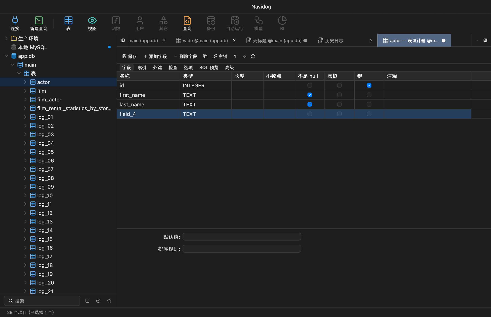
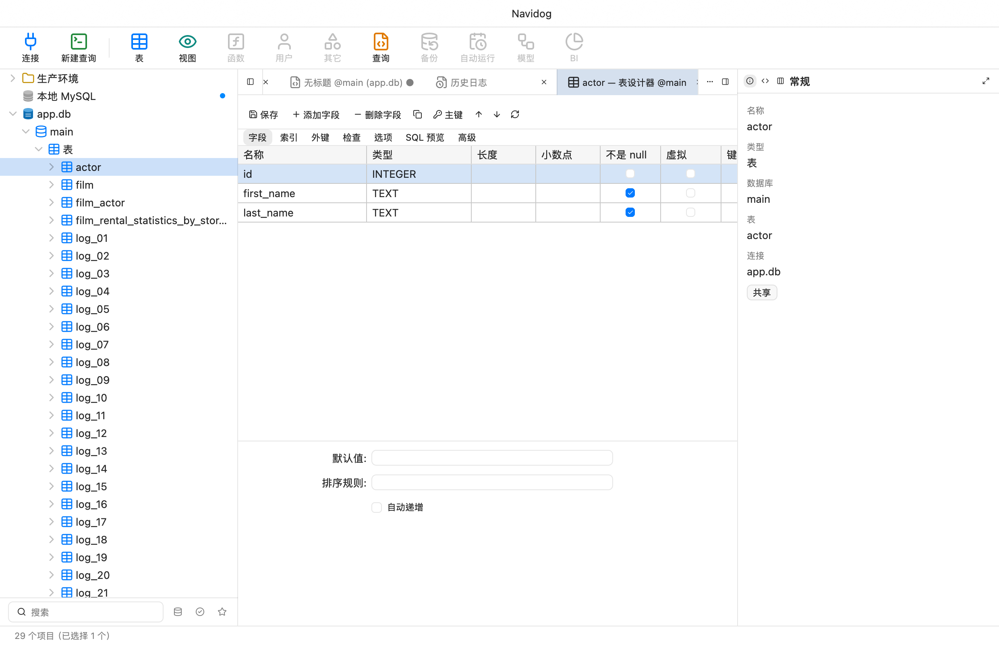
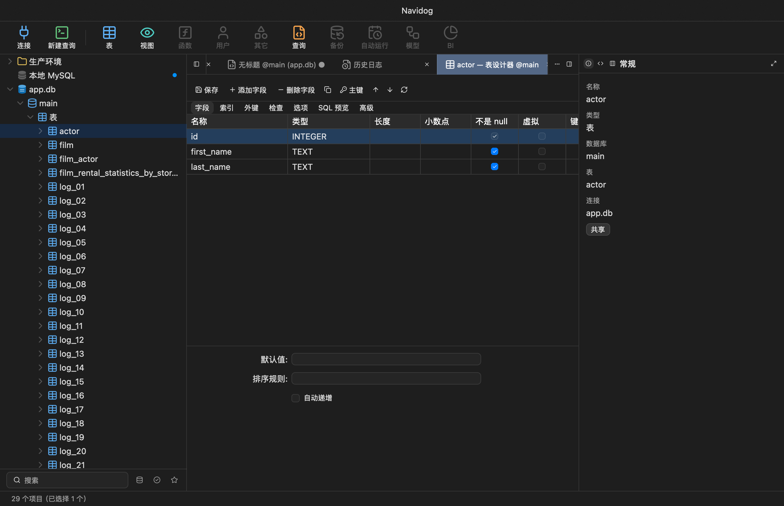
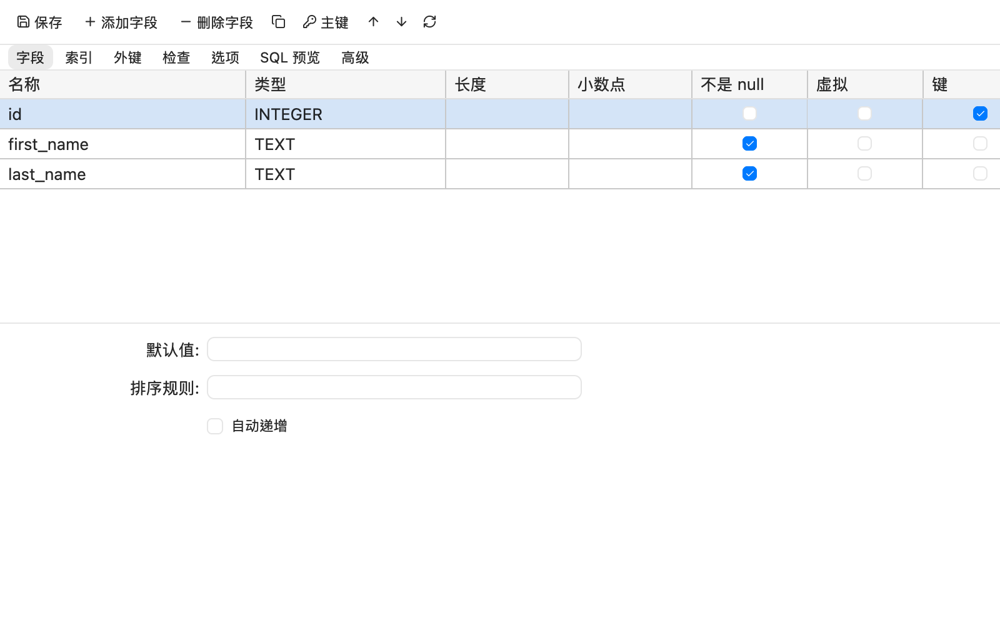

# M4 表设计器截图

2026-10-19 截图测试生成的 Navidog 界面。外键浅深色截图已更新为元数据级联选择版，其余归档自实现提交 `72e8d74`。使用本地测试数据；表单与 SQL 预览展示草稿，不代表截图中的变更已经执行。

| 场景 | 浅色 | 深色 |
| --- | --- | --- |
| 字段与属性 | [查看](designer.png) | [查看](designer-dark.png) |
| 新增字段草稿 | [查看](designer-grid-light.png) | [查看](designer-grid-dark.png) |
| 索引 | [查看](designer-indexes-light.png) | [查看](designer-indexes-dark.png) |
| 外键 | [查看](designer-foreign-keys-light.png) | [查看](designer-foreign-keys-dark.png) |
| 检查约束 | [查看](designer-checks-light.png) | [查看](designer-checks-dark.png) |
| 选项状态说明 | [查看](designer-options-light.png) | [查看](designer-options-dark.png) |
| SQL 预览 | [查看](designer-preview.png) | [查看](designer-preview-dark.png) |
| 小视口（800 × 500） | [查看](designer-minimum-light.png) | [查看](designer-minimum-dark.png) |

## 宽窗字段网格

隐藏右侧检查器后展示全部八列。

## 字段与属性

## 小视口

独立创建 800 × 500 逻辑尺寸窗口，验证实际布局。

完整表选项及运行态 Navicat 并排像素校准仍待完成，详见[验收记录](../../acceptance-m4.md)。本目录仅包含 Navidog 截图，不包含 Navicat 专有参考资料。
